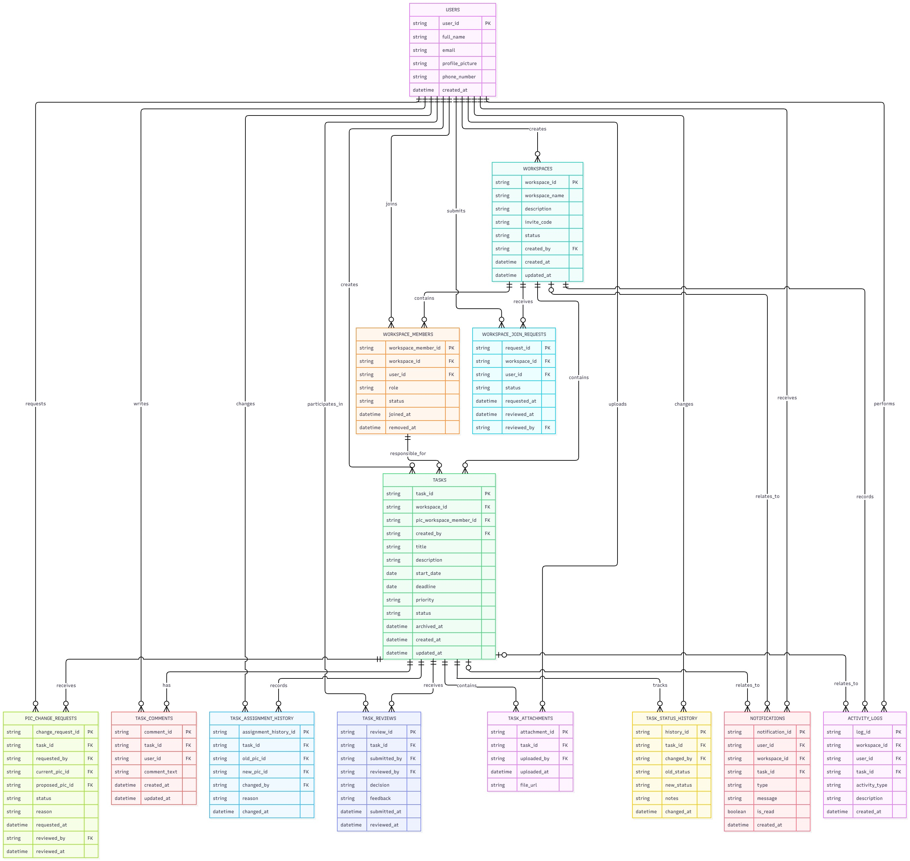

# Dokumentasi Backend CreaFlow

backend CreaFlow (`package:creaflow`).

**Firebase Auth + Cloud Firestore (Spark Plan)**. 

---

## 1. Cara Setup & Run

### Setup di `main.dart`

Panggil `initFirebase()` sebelum `runApp(...)`:

```dart
import 'package:flutter/material.dart';
import 'package:creaflow/core/firebase_bootstrap.dart';

Future<void> main() async {
  WidgetsFlutterBinding.ensureInitialized();
  await initFirebase();
  runApp(const MyApp());
}
```

### Jalanin Aplikasi (Live vs Emulator)

- **Pakai Firebase asli:**

  ```powershell
  flutter run
  ```
- **Pakai Emulator lokal**

  1. Buka terminal di `tugas_akhir`, nyalakan emulator:
     ```powershell
     firebase emulators:start --only "auth,firestore"
     ```
  2. Di terminal lain, jalankan Flutter dengan flag `USE_EMULATOR=true`:
     ```powershell
     flutter run --dart-define=USE_EMULATOR=true
     ```

  *(Tenang, `initFirebase()` sudah otomatis ngarahin Android Emulator ke `10.0.2.2` dan platform lain ke `localhost`.)*

### Import Model

Semua model & enum sudah dikumpulin di satu file, jadi cukup import ini saja:

```dart
import 'package:creaflow/data/models/models.dart';
```

---

## 2. ERD & Struktur Data Singkat



Struktur koleksi di Firestore kurang lebih seperti ini:

- `users/{userId}` → profil user (di dalamnya ada subkoleksi `notifications`)
- `inviteCodes/{code}` → mapping kode undangan 8 huruf ke `workspaceId`
- `workspaces/{workspaceId}` → data workspace, dengan subkoleksi:
  - `members/{userId}` (ID dokumen = `userId`)
  - `joinRequests/{userId}` (ID dokumen = `userId`)
  - `activityLogs/{logId}`
  - `tasks/{taskId}` → di dalamnya ada subkoleksi: `attachments`, `comments`, `statusHistory`, `reviews`, `picChangeRequests`, `assignmentHistory`

---

## 3. Alur Status Tugas & Role

Alur status tugas kita pakai aturan ini:

- **`todo`** → **`in_progress`** → **`in_review`**
- Dari **`in_review`**, **PM** bisa pilih:
  - **`done`** (disetujui)
  - **`revision`** (minta revisi, nanti PIC ubah lagi ke **`in_progress`**)

**Siapa boleh ngapain:**

- **PM:** buat/edit/arsip/pulihkan tugas, review tugas (`done`/`revision`), approve/reject join request, ubah role/keluarkan member.
- **PIC:** kerjakan tugas & ajukan review (`todo` → `in_progress` → `in_review`, atau `revision` → `in_progress`).
- **Member aktif lain:** lihat tugas, tambah komentar, tambah lampiran link, dan ajukan permintaan ganti PIC.

> **Tips buat UI:** Pakai `TaskStatusTransition.allowedNextStatuses(current: task.status, isPm: ..., isPic: ...)` dari `lib/core/utils/task_status_transition.dart` supaya tombol status yang muncul otomatis sesuai role user.

---

## 4. Daftar Service yang Dipakai FE

### A. Auth & Profil (`AuthService` & `UserRepository`)

- `AuthService` (`lib/services/auth_service.dart`):
  - `register({fullName, email, password, phoneNumber?})` → daftar akun + simpan ke Firestore (kalau gagal simpan Firestore, akun Auth otomatis di-rollback)
  - `login({email, password})` → login & ambil `UserModel`
  - `logout()`
  - `getCurrentUserProfile()`
  - `sendPasswordResetEmail(email)`
  - Getter/Stream: `currentUser`, `currentUid`, `authStateChanges`
- `UserRepository` (`lib/data/repositories/user_repository.dart`):
  - `getUserById(uid)`, `watchUser(uid)`
  - `updateProfile({uid, fullName?, profilePicture?, phoneNumber?, clearProfilePicture, clearPhoneNumber})`

```dart
final authService = AuthService();
final user = await authService.login(
  email: 'budi@example.com',
  password: 'password123',
);
```

### B. Workspace & Member (`WorkspaceService`)

Lokasi: `lib/services/workspace_service.dart`

- **Workspace:** `createWorkspace({name, description?})`, `watchMyWorkspaces()`, `getMyWorkspaces()`, `watchWorkspace(workspaceId)`, `updateWorkspace(...)`, `regenerateInviteCode(workspaceId)`
- **Gabung via Kode / QR:** `joinWorkspaceByCode(rawCode)` — bisa nerima kode 8 huruf biasa (`ABCD2345`) **atau** hasil scan QR (`creaflow://join/ABCD2345`).
  - *Buat bikin string QR-nya di UI, pakai `InviteCodeGenerator.toQrPayload(workspace.inviteCode)`.*
- **Approval & Member:** `watchPendingJoinRequests(workspaceId)`, `approveJoinRequest(...)`, `rejectJoinRequest(...)`, `watchMembers(workspaceId)`, `getMembers(workspaceId)`, `changeMemberRole(...)`, `removeMember(...)`, `leaveWorkspace(workspaceId)`.
  - *Catatan: PM terakhir tidak bisa keluar/diturunkan rolenya sebelum menunjuk PM lain.*

### C. Tugas Inti (`TaskService`)

Lokasi: `lib/services/task_service.dart`

- `createTask({workspaceId, picMemberId, title, description?, startDate?, deadline?, priority})` *(khusus PM)*
- `watchTasks(workspaceId, {includeArchived = false})`, `getTasks(...)`
- `watchTask(workspaceId, taskId)`, `getTask(workspaceId, taskId)`
- `updateTask(...)` *(khusus PM; tugas yang diarsip tidak bisa diedit)*
- `updateTaskStatus({workspaceId, taskId, newStatus, notes?})` *(otomatis nyatat ke `statusHistory`)*
- `archiveTask(workspaceId, taskId)`, `unarchiveTask(workspaceId, taskId)` *(khusus PM)*

### D. Kolaborasi Tugas (`TaskCollaborationService`)

Lokasi: `lib/services/task_collaboration_service.dart`

- **Komentar:** `addComment(...)`, `updateComment(...)` *(pemilik saja)*, `deleteComment(...)` *(pemilik atau PM)*, `watchComments(workspaceId, taskId)`
- **Lampiran (Link URL):** `addAttachment({workspaceId, taskId, fileUrl})`, `deleteAttachment(...)`, `watchAttachments(workspaceId, taskId)`
  - *Catatan Spark Plan: lampiran pakai link `http://` atau `https://` (misal Google Drive/Figma), bukan upload file langsung.*
- **Review & Riwayat:**
  - `submitForReview({workspaceId, taskId, notes?})` → ubah status ke `in_review`, buat data review, catat log, dan kirim notif ke semua PM aktif.
  - `reviewTask({workspaceId, taskId, reviewId, decision, feedback?})` → khusus PM. `decision` pakai `ReviewDecision.approved` atau `ReviewDecision.revision` *(kalau `revision`, `feedback` wajib diisi)*.
  - `watchReviews(workspaceId, taskId)`, `watchStatusHistory(workspaceId, taskId)`
- **Ganti PIC:** `requestPicChange(...)`, `approvePicChangeRequest(...)`, `rejectPicChangeRequest(...)`, `watchPicChangeRequests(...)`, `watchAssignmentHistory(...)`

### E. Notifikasi & Activity Log (`NotificationService`)

Lokasi: `lib/services/notification_service.dart`

- `watchMyNotifications({unreadOnly = false, limit = 50})`
- `markAsRead(notificationId)`, `markAllAsRead()`
- `watchWorkspaceActivityLogs(workspaceId, {limit = 50})`
- `checkDeadlineReminders(tasks, {now?})` → mengembalikan `DeadlineReminderResult` (`dueTomorrowTasks`, `overdueTasks`, `hasReminders`) buat cek pengingat H-1 dan tugas telat di client.

### F. Dashboard & Filter (`DashboardService`)

Lokasi: `lib/services/dashboard_service.dart`

- `getWorkspaceDashboard(workspaceId, {onlyMyTasks = false})` & `watchWorkspaceDashboard(...)` → mengembalikan `DashboardSummaryModel` (punya `todoCount`, `inProgressCount`, `inReviewCount`, `revisionCount`, `doneCount`, `overdueCount`, `dueTomorrowCount`, `totalTasks`, `activeTasks`, `completionRate`).
- `getFilteredTasks(workspaceId, {filter})` & `watchFilteredTasks(...)` → pakai `TaskFilter` (`status`, `priority`, `picMemberId`, `deadlineFrom`, `deadlineTo`, `overdueOnly`, `includeArchived`, `sortBy` dari `TaskSortBy`).

---

## 5. Cara Handle Error & Validasi

Semua service melempar custom exception (`AppAuthException`, `WorkspaceException`, `TaskException`, `NotificationException`) yang sudah punya `e.message` bahasa Indonesia. Jadi di UI tinggal tangkap dan tampilkan di `SnackBar`:

```dart
try {
  await taskService.createTask(
    workspaceId: workspaceId,
    picMemberId: picId,
    title: titleController.text,
  );
} on TaskException catch (e) {
  ScaffoldMessenger.of(context).showSnackBar(
    SnackBar(content: Text(e.message)),
  );
}
```

**Batas validasi singkat (biar form FE sinkron):**

- Password minimal **6 karakter**, email harus ada `@`, `fullName` & nama workspace max **100 karakter**.
- Judul task max **150 karakter**, deskripsi task & komentar max **2000 karakter**, deskripsi workspace & alasan ganti PIC max **500 karakter**.
- `deadline` tidak boleh lebih awal dari `startDate`.
- Lampiran harus berupa URL `http://` atau `https://`.
- `feedback` review **wajib diisi** kalau PM memilih `ReviewDecision.revision`.

